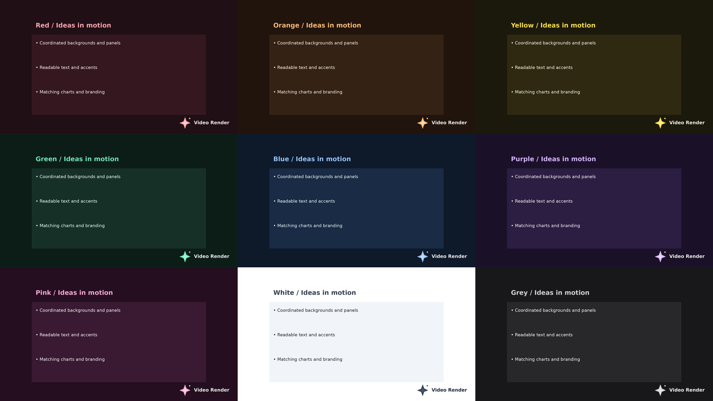
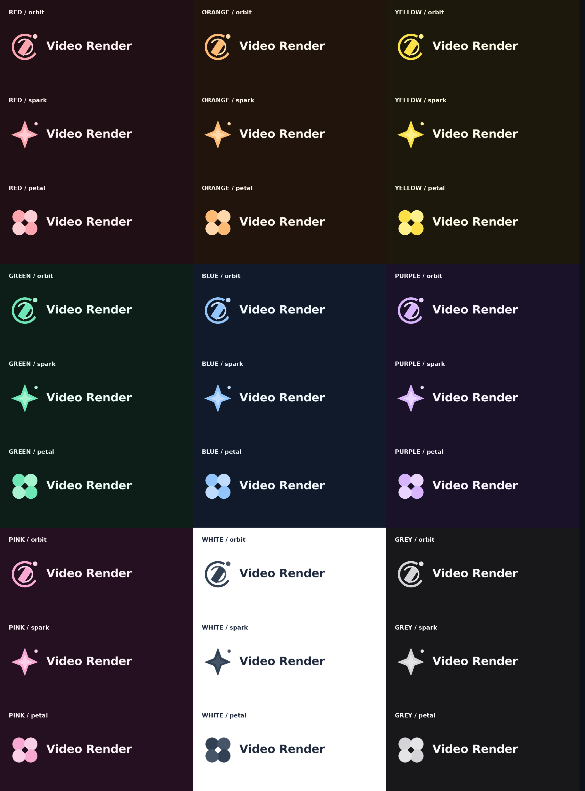
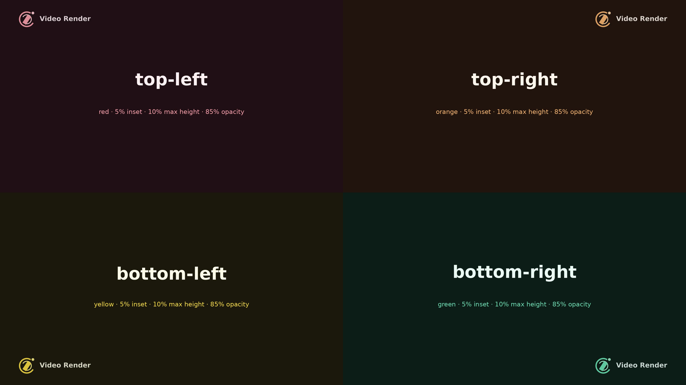
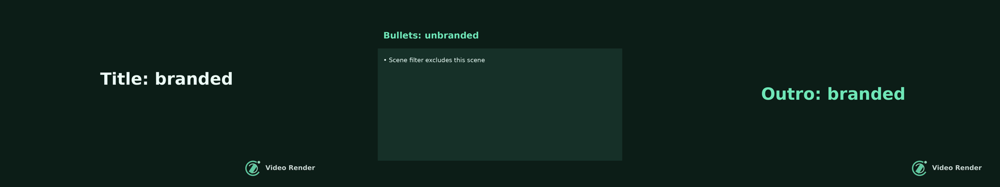

# Branding and colour scheme review evidence

The optional `branding` block adds a fixed logo above scene animations in
both the normal and streamed MP4 paths. It supports all four corners,
frame-relative inset and maximum height, opacity multiplied by PNG alpha,
and filtering by scene type. Supply a PNG or generate a transparent
wordmark and motif from a name, style, palette, and optional custom hex
colours. See the main README and `samples/branding-spec.json` for the contract.

The branding sample retains the full five-slide quarterly review, including
its original wording, narration, voice, chart data, timings and image prompt.
Only branding and theme colours differ from `samples/sample-spec.json`.
The synthetic slides shown below are isolated visual test fixtures, not
replacement scripts for an existing presentation.

## Whole-video colour schemes

Set `"theme": {"color_scheme": "purple"}`. Options are red, orange, yellow,
green, blue, purple, pink, white, and grey. The chosen scheme controls
backgrounds, panels, text, captions, borders, charts, and generated branding.
Existing dark/light rendering remains unchanged when no scheme is selected.



[Watch the rendered colour scheme video](color-schemes.mp4)

Each scheme was rendered as a four-scene MP4 (title, bullets, bar chart, pie
chart), with a corresponding editable PPTX. Detailed contact sheets:

| Colour | Evidence | Colour | Evidence | Colour | Evidence |
| --- | --- | --- | --- | --- | --- |
| Red | [Slides and charts](scheme-red.png) | Orange | [Slides and charts](scheme-orange.png) | Yellow | [Slides and charts](scheme-yellow.png) |
| Green | [Slides and charts](scheme-green.png) | Blue | [Slides and charts](scheme-blue.png) | Purple | [Slides and charts](scheme-purple.png) |
| Pink | [Slides and charts](scheme-pink.png) | White | [Slides and charts](scheme-white.png) | Grey | [Slides and charts](scheme-grey.png) |

Curated text colours meet [4.5:1 contrast](https://www.w3.org/WAI/WCAG22/Understanding/contrast-minimum.html)
on both canvas and panel backgrounds. Chart fills meet [3:1 contrast](https://www.w3.org/WAI/WCAG22/Understanding/non-text-contrast.html)
against both; pie percentage text meets 4.5:1 against every slice fill.
Direct category/value labels keep [colour from being the only way to read information](https://www.w3.org/WAI/WCAG22/Understanding/use-of-color.html).
These are solid colour-pair checks at full visibility; they do not certify
arbitrary custom overrides, photo content, transitions, or logo opacity.

Generated brands inherit the chosen scheme automatically. The three logo
motifs also support optional logo-only overrides using the same nine names.



## Screenshots and videos

These screenshots are decoded from actual 1920×1080 MP4 renders, sampled
at the middle of each scene and reduced into contact sheets. The generated
RGBA logos have transparent backgrounds and smoothly antialiased edges.
The corner demo uses the orbit motif in red, orange, yellow and green, a 5% inset,
10% maximum height, and 85% opacity.



[Watch the four-corner video](four-corners.mp4)

The filter demo uses `"scenes": ["title", "outro"]`; the middle bullets
scene has no overlay.



[Watch the scene-filter video](title-outro-only.mp4)

These files are included in the change so a PR can link to this directory
and embed the screenshots in its Evidence section before review.

## Verification

```sh
.venv/bin/python -m unittest discover -s tests -v
.venv/bin/python scripts/branding_evidence.py
.venv/bin/python scripts/theme_evidence.py
```

- Sixteen tests pass: four-corner placement, exact pixel blending and unchanged
  pixels outside the logo, PNG alpha, opacity including zero, default
  sizing and positioning, maximum-height scaling and wide-logo fitting,
  scene filtering, input validation, and spec-relative logo paths. Generated
  marks are tested across all 27 style/palette combinations for transparent
  backgrounds, antialiasing, deterministic output, and distinct colours.
  Custom colour overrides and generated-spec loading are also covered.
- Content regression checks compare the branded sample with the original
  presentation and verify all nine colour schemes retain the script, voice,
  metadata and timing while reusing the same cached narration without new
  speech requests.
- Theme tests cover all nine schemes, semantic contrast pairs, logo
  inheritance and overrides, legacy defaults, scene backgrounds, panels,
  captions, spotlight borders, background-image text surfaces, all three
  chart types, and shared PowerPoint colour tokens.
- Integration coverage samples frames at the encoder boundary for both
  normal (3 scenes) and streamed (13 scenes) timelines with zoom animation.
  Excluded scenes remain byte-identical to unbranded frames; selected
  scenes change only within the fixed logo bounds. Encoding is mocked for
  these pixel checks to avoid lossy compression affecting comparisons.
- Actual MP4 smoke renders produced the videos above. The contact sheets
  were visually checked for inset corners and filtering.
- A separate actual-encoding regression compared a two-scene, four-second,
  8fps title/outro spec without branding using the original renderer from
  commit `0542810` and the changed renderer (MoviePy 2.1.2). Both MP4 files
  had SHA-256 `6bae0edfb4de4db5bd997f096c95f768403f0df405852f78d1a325244169c249`.
  The files and spec are in the ignored `output/branding-evidence/` folder.

No API keys, narration, or generated AI images are needed to reproduce the
branding tests or evidence. The logo overlay applies to MP4 output.
Colour schemes also apply to the editable PPTX export.
